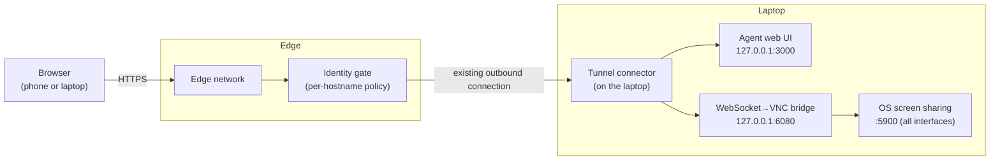
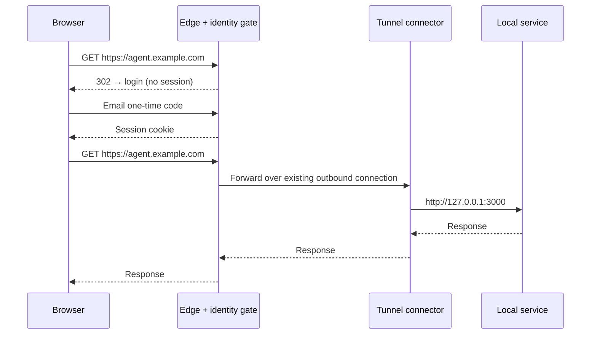

I run a coding agent on my laptop. It holds my repositories, credentials, and tools, and its web UI binds to `127.0.0.1`. That default is correct security, and it also leaves the agent unreachable the moment I step away. I made the agent, and the desktop it runs on, reachable from any browser with no ports opened to the internet, nothing installed on the devices I connect from, and every request authenticated before it reaches the machine.

## Context and requirements

The agent runs arbitrary commands with my privileges, so exposing its UI is exposing a shell. Remote access is a security problem before it is a convenience.

- **Browser-only clients.** A phone or borrowed laptop needs nothing beyond a browser.
- **Authentication before the origin.** Unauthenticated requests never reach the laptop, not even the agent's login page.
- **No inbound exposure.** No port-forwarding, no public IP; the services I add listen on loopback only.
- **Remote desktop.** Some workflows need the full GUI, not just the web UI.
- **Explicit lifecycle.** I start and stop the stack deliberately; it is not a login daemon.

Non-goals: multi-user access, high availability, and use while the laptop is asleep or offline.

## Design

Three layers: an outbound tunnel from the laptop to an edge network, an identity gate at that edge, and local services that stay on loopback.



- **Tunnel connector.** Opens outbound connections to the edge, which routes each hostname down to a local service. Nothing accepts inbound traffic.
- **Identity gate.** Each hostname has an edge access policy. Requests without a session are redirected to a login flow and only forwarded once it passes.
- **Local services.** The agent's web UI on `127.0.0.1:3000`, and a WebSocket-to-VNC bridge on `127.0.0.1:6080` in front of the built-in screen-sharing server.

The laptop sees nothing until the identity check succeeds:



<figure>
  
  <figcaption>The identity gate. A requestor logs in before anything is forwarded to the laptop.</figcaption>
</figure>

Routing is one declarative table:

```yaml
ingress:
  - hostname: agent.example.com
    service: http://127.0.0.1:3000
  - hostname: desk.example.com
    service: http://127.0.0.1:6080
  - service: http_status:404   # anything not listed above fails closed
```

The catch-all matters: a hostname pointed at the tunnel by mistake returns `404` instead of reaching a service.

## Decisions

| Decision | Chosen | Alternatives considered | Why |
|---|---|---|---|
| Transport | Cloudflare Tunnel | Port-forwarding, Tailscale (incl. Funnel), ngrok | Outbound-only; tunnels, DNS, and policies live in one account with one CLI; WebSockets pass through. Costs a domain, and Cloudflare terminates TLS at its edge. |
| Authentication | Cloudflare Access, email one-time code | App-level password, IP allow-list, VPN | The check happens before a request reaches the machine; sessions expire and revoke centrally. No shared password, so your email becomes the root of trust. |
| Remote desktop | Built-in screen sharing (VNC) + noVNC | Guacamole, MeshCentral, RustDesk | OS-native, so no screen-recording permission for a third party, with a tiny stack. VNC auth alone is weak, and macOS ignores remote resizing. |
| Lifecycle | On-demand start/stop script | launchd / systemd | Exposure stays a deliberate choice, not a permanent property of the machine. The cost is that a crash stays down until I notice. |

The agent's own host allow-list stays enabled behind all of this as a second layer.

## Security posture

- The agent and the bridge bind to `127.0.0.1`; from the internet, the tunnel is the only path in.
- macOS Screen Sharing listens on port 5900 on all interfaces and cannot be restricted to loopback. It is reachable on the local network but not the internet. I limit it to my account, rely on Apple Remote Desktop authentication, and keep the firewall on.
- Every routed hostname has a policy; unrouted hostnames fail closed at the connector.
- The tunnel credential lives in a mode-`0600` file and is passed with `--token-file`, so it never appears in process listings or shell history.

Residual risks: compromise of the email account, reliance on Cloudflare as an intermediary, the Screen Sharing listener on shared Wi-Fi, and an unlocked desktop anyone with physical access can use. Hardening I still want: validate the Access token and audience at the connector so an unpolicied hostname fails closed, and shorten the desktop session duration.

## Running it unattended

On demand is the default, but three things let it run unattended: the laptop must not sleep (`sudo pmset -a sleep 0 displaysleep 0 disksleep 0`), it must stay logged in with auto-lock off so the desktop shows instead of the lock screen, and the lid stays open (clamshell with an external display also works). To start the stack on boot, load the same script under launchd or systemd with `RunAtLoad`, or keep `caffeinate` in a login item. The trade-off is unchanged: an always-on, always-unlocked desktop is a bigger target, so leave it up only where the machine is physically secure.

## What broke along the way

1. **The agent rejected the public hostname.** Its web server validates `Host` and `Origin` headers, a DNS-rebinding defense, and answered `Untrusted request`. Rewriting `Host` at the connector would have broken the UI's own same-origin checks. The fix was to add the public hostname to the application's allow-list.
2. **Enabling Access through the API left no login method.** The dashboard adds a one-time-code provider for you; the API does not. The login page reported "no login methods available" until I created it explicitly.
3. **noVNC asked for a username.** macOS advertises Apple Remote Desktop authentication first, so noVNC expects the macOS account, not the VNC password. I briefly patched the client to prefer VNC auth, then reverted it to keep the checkout upstream-clean.
4. **The desktop cannot be resized.** macOS ignores client resize requests. Scale client-side in noVNC (`resize=scale`) or lower the display resolution.
5. **Restarting the agent from inside the agent ends the session.** The restart shell is a child of the process it kills. Change the agent's server from a separate terminal.
6. **launchd services do not inherit the shell's `PATH`.** Homebrew binaries need absolute paths, one more reason to use an explicit script.

<figure>
  
  <figcaption>noVNC asks for a username because it negotiates Apple Remote Desktop authentication, not plain VNC.</figcaption>
</figure>

## Result

`agent.example.com` and `desk.example.com` resolve to the edge. After an email one-time code, they reach the agent UI and the desktop. The laptop runs three processes, the tunnel connector, the VNC bridge, and the agent, and accepts no inbound connections from the internet.

<figure>
  
  <figcaption>The agent's web UI on a phone, after the one-time code.</figcaption>
</figure>

The step-by-step setup, with verification and teardown, is in the [companion guide](/blog/remote-access-quick-setup/).