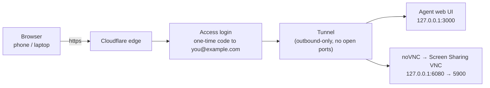

You've got an agent that can read files, run commands, and do real work — but it only lives on the machine in front of you. Walk away and it's unreachable. This post walks through a setup that makes a local agent (and the desktop it runs on) reachable from any browser, on any device — without installing an app on the phone or laptop you're connecting *from*, and without opening a single inbound port on your home network.

## The problem

Local dev tools and agent harnesses bind to `127.0.0.1` by default. They're designed to be opened on the same machine, not across the internet. The usual ways to reach them remotely all miss at least one of my requirements:

- **Port-forwarding** on the router needs a public IP, exposes your network, and is hard to secure well.
- **A VPN** is solid but wants a client app on every device — exactly what I didn't want.
- **Moving the agent to a hosted box** solves reachability but loses "run it on my own machine, with my files and my tools."

What I actually wanted was three things, together:

1. **Browser-only access** — no installs on the phone or second computer.
2. **Real authentication** — not a URL that's only "secure" because it's long.
3. **Remote desktop** — see and control the actual desktop, not just one web UI.

## The high-level design

Two things need to get out: the agent's web UI and the desktop itself. Both are ordinary local services — a web server on a loopback port, and the operating system's built-in screen-sharing server. The trick is to connect them to the internet with an **outbound-only tunnel**, then put an **identity layer in front of everything** so unauthenticated traffic never reaches the machine.



Three moving parts:

1. **The tunnel** runs on the laptop and *dials out* to a cloud edge. Inbound traffic arrives at the edge, is relayed down that already-open outbound connection, and lands on the local service. No router changes, no public IP, no inbound firewall rules.

2. **The identity layer** sits at the edge. Before anything is relayed, the requester has to prove who they are — here, a one-time code emailed to an address only you control.

3. **The desktop bridge** converts the OS's native screen-sharing protocol into something a browser understands, so "see and control the desktop" becomes just another tab.

The whole routing table fits in one config file:

```yaml
# one tunnel, two hostnames, two local services
ingress:
  - hostname: agent.yourdomain.com
    service: http://127.0.0.1:3000
  - hostname: desk.yourdomain.com
    service: http://127.0.0.1:6080
  - service: http_status:404
```

## What I chose, and why

### Tunnel: Cloudflare Tunnel (outbound-only) over ngrok, Tailscale, or port-forwarding

The hard requirement was "no client installs," which rules out a VPN like Tailscale (great tool, but it wants an app on every device). Raw port-forwarding has no app either, but you're directly exposing a service with no identity layer in front — and you need a public IP. ngrok is the closest cousin: it also gives a public URL from an outbound connection, but its free tier historically limited how many tunnels you could run, made custom hostnames a paid feature, and left auth as a separate thing to bolt on.

Cloudflare Tunnel won because:

- the client is a single binary already running on the laptop,
- one connection can fan out to **multiple hostnames → multiple local services**,
- WebSockets pass through (required for the desktop bridge),
- and the **Access** identity layer is a sibling product, not a separate integration.

Tradeoff: you need a domain (any domain you own, pointed at Cloudflare). That's the one real requirement.

### Auth: Cloudflare Access (email one-time code) over a shared password or an IP allowlist

A shared password is a static secret — it can leak and can't be revoked per-device. An IP allowlist breaks the moment you're on cellular. Access gives per-user policies ("only this email"), a login page that works in any browser, and sessions that expire.

Tradeoff: Access offers email one-time codes or a federated identity provider (Google, GitHub, etc.) — there's no plain "username + password" field. If you specifically want a typed password, add one at the app layer too; that's belt-and-suspenders, not a replacement.

### Desktop: built-in Screen Sharing (VNC) + noVNC over Guacamole, MeshCentral, or RustDesk

The OS's own screen-sharing server captures the screen with no per-app screen-recording permission prompts. noVNC is a static web app that speaks VNC in the browser. That pair was the smallest thing that satisfied "see and control the desktop in a tab."

Honest tradeoffs:

- **Guacamole** is the "proper" gateway — VNC/RDP/SSH in one web UI with user accounts — but it's a heavier stack to run and secure.
- **MeshCentral** is excellent and self-hostable, but brings its own agent; on macOS that means a screen-capture permission dance I'd rather avoid.
- **RustDesk** needs a relay, and the browser path still needs a web-client setup.
- macOS VNC ignores client-requested resizes, so "make the desktop smaller" has to happen in noVNC (local scaling) or by lowering the display resolution — a quirk worth knowing before you squint at your phone.

### The 24/7 part

None of this helps if the laptop sleeps. The last ingredient is boring but essential: disable sleep, disable auto-lock so the desktop is actually visible, and run the three local processes under a tiny start/stop script rather than as login daemons — reachable when I say so, not silently running forever.

## The result

From any browser, on any device: `agent.yourdomain.com` opens the agent after an email one-time code, and `desk.yourdomain.com` opens the actual desktop. Nothing is installed on the devices you connect from. The only things running on the laptop are an outbound tunnel, a small web bridge, and the agent you already had.

For the copy-paste version, see the quick-start companion post.
